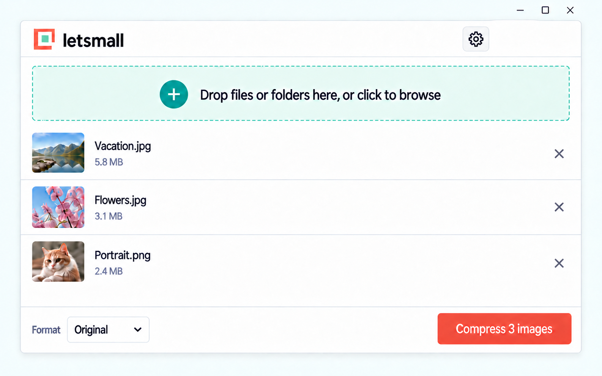
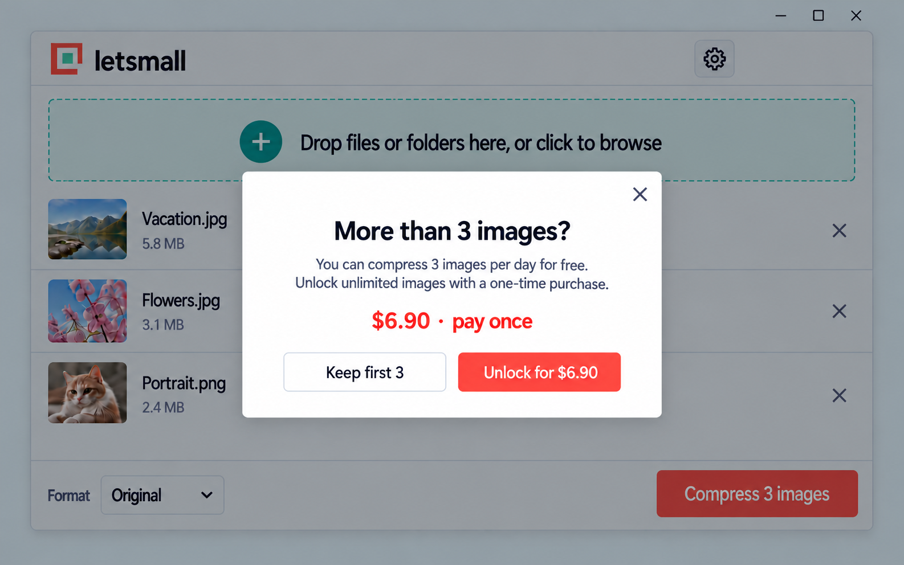
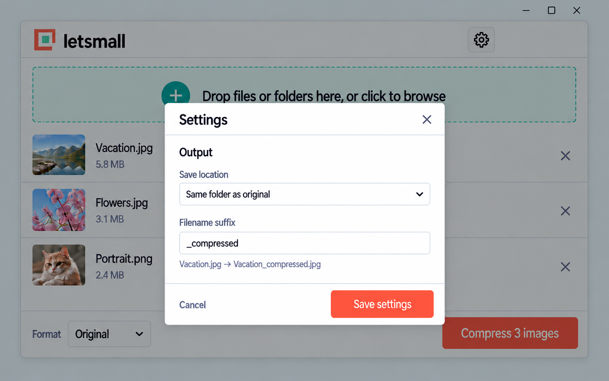

## Context

项目目前没有应用代码或既有规范，仅有 OpenSpec 配置。首版面向 Windows；界面为英文，图片内容只在本机处理。行为范围见 [proposal.md](proposal.md) 和两份 delta spec。

最终视觉参考：

| 状态 | 设计图 |
| --- | --- |
| 主界面 |  |
| 超额与支付提醒 |  |
| 设置窗口 |  |

图中示例内容用于说明布局；实际图片名称、数量、价格状态与按钮文字由运行状态决定。三图均采用橘色按钮、薄荷色导入区，设置入口位于右上角。

## Goals / Non-Goals

**Goals:**

- 让添加文件或文件夹、选择格式、开始压缩成为主界面的主要路径。
- 将保存位置和文件名后缀收进设置窗口，默认安全地在原图旁生成新文件。
- 将压缩过程与支付授权分开：图片不离开本机，只有授权操作需要联网。
- 将 Windows 安装包控制在 30 MiB 以内、应用自身安装文件控制在 50 MiB 以内；两项均以实际发布构建测量。

**Non-Goals:**

- 首版不制作 macOS 安装包，不处理动态图片、视频或云端图片压缩。
- 不在主界面加入常驻额度、价格、输出目录或批量高级参数。

## Decisions

### Windows 桌面结构

采用 C# WPF 构建 Windows 原生界面，目标为 Windows 10 22H2 / Windows 11 已包含的 .NET Framework 4.8。JPG/PNG 优先使用 Windows 图像组件，WebP 随应用提供所需编解码器。界面、文件处理和队列保持在一个 Windows 应用中，不使用 WebView2、Chromium、Node.js 或额外的桌面框架。首版不支持 AVIF，以减少编解码依赖和安装体积。

在界面开发前先做 JPG、PNG、WebP 的最小可运行打包实验，记录安装包、应用自身安装文件、输出质量和速度。30 MiB / 50 MiB 是发布门槛，不是未经实测的成品承诺；超标时先检查图片依赖和打包内容。

### 导入与队列

统一导入区接受 Windows 拖入的文件和目录；点击导入区弹出一个只含 `Files`、`Folder` 的小菜单，再调用相应系统选择器。枚举文件夹时递归扫描、去重规范化绝对路径，并限制并发扫描和压缩数量。队列记录源路径、格式、状态、原始大小、输出大小与错误信息。用户可以在开始前移除单张图片；单张失败不停止整批。

### 输出与文件安全

默认输出路径由“原文件父目录 + 原文件名主体 + `_compressed` + 目标格式扩展名”构成，例如 `Vacation.jpg` → `Vacation_compressed.jpg`。设置可改为自选目录，并可修改后缀；设置窗口实时显示命名示例。输出先写到目标目录的临时文件，成功后再以不覆盖的方式确定最终名称；若名称占用则追加序号。原文件始终不被作为写入目标。格式转换时根据目标格式处理透明通道和方向信息，并在实现阶段用真实图片验证视觉结果。

### 免费额度与购买

本地记录当前安装实例的已成功输出数量和最近使用日期。导入导致待处理数量超过剩余额度时立即提示；用户选择保留免费额度内的图片时，只收下额度允许的前几张。压缩结果成功落盘后才扣一次，失败或取消不扣。将最近使用日期用于避免系统时钟回退时重复重置额度，但本地计数仍属于轻量限制。

购买按钮在系统浏览器打开配置好的托管结账页；支付服务的服务端回调确认订单后签发授权，应用收到并验证授权后解除额度。应用包内不保存支付密钥，不仅凭浏览器返回页面就解锁。结账取消或失败时保持原队列和免费状态。支付提供商应通过独立适配层接入，待商户主体与可用收款渠道确定后配置。

支付确认后，网页通过 `letsmall://activate` 唤起应用，只传递短时、一次性的领取凭证，不在链接中放永久许可证。应用将凭证和本机标识提交给授权服务；服务端原子地将订单绑定到首台电脑并消耗凭证，随后返回包含订单及设备标识的签名许可证。每笔订单生成不同的授权，不能用同一凭证激活第二台电脑。应用只保存许可证及验签公钥，后续启动本地验签并核对本机标识，无须每次联网。签名私钥只保存在服务端。

许可证保存在独立于应用安装目录的本机用户数据目录（例如 `%LOCALAPPDATA%\letsmall`）；卸载应用时不删除该文件，同一用户在同一台电脑重装应用后可直接本地验签继续使用。若用户清理了许可证文件、重装 Windows 导致用户数据丢失，或更换电脑，则需重新购买；首版不提供凭订单信息联网补发、授权转移、换机重置或人工例外。设备标识应尽量稳定且只用于授权判断，不能把单个容易变化的硬件字段作为唯一依据。

## Risks / Trade-offs

- [本地免费额度可被重装或修改数据绕过] → 首版将其定位为轻量限制；若需要严格防滥用，后续改为服务端额度并增加联网要求。
- [原图目录可能只读、磁盘空间不足或输出文件重名] → 逐张报告失败原因，使用临时文件与不覆盖命名，绝不修改原图。
- [大文件夹或高分辨率图片可能占用过多内存] → 限制扫描及压缩并发，按文件流转任务，不一次载入整批图片。
- [支付提供商及商户资格尚未确认] → 先定义结账、回调、授权边界；正式购买功能上线前必须完成渠道选择和端到端验证。
- [本地许可证可能被清理，设备标识可能因系统或硬件变化而失效] → 验证应用卸载后许可证仍在、同机重装应用可用；许可证丢失或无法识别原设备时须重新购买，并在购买说明中明确告知。
- [WebP 编解码器与图像资源可能使包体超标] → 先做最小安装包并实际测量，只包含首版必需文件。

## Migration Plan

这是全新应用，无既有数据迁移。先验证 JPG/PNG/WebP 与 Windows 安装包体积，再交付可安装的压缩流程，之后接入额度、结账与授权；正式发布前复测体积、三张设计图对应的界面、主要文件格式和支付沙箱。回退时停止分发有问题的安装包并发布修复版，已有原图和压缩结果不受应用回退影响。

## Open Questions

- 具体美元收款服务商、商户主体与税费展示方式，待上线购买功能前根据实际账户条件确定；不改变 `$6.90` 一次性解锁的产品规则。
